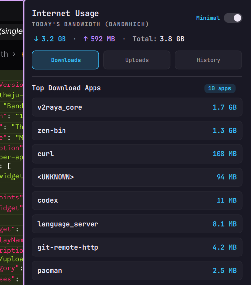

# Bandwidth Monitor for Omarchy

Daily internet bandwidth monitor plugin for Omarchy / Quickshell. Shows live daily bandwidth consumption in the status bar and provides a detailed breakdown popup by application and 30-day historical usage.



## Features

- **Status Bar Widget**: Shows live daily internet usage (`󰖟 2.6 GB`) directly in the top bar.
- **Detailed Popup Panel**:
  - Live summary of total, download (`↓`), and upload (`↑`) traffic.
  - **Downloads Tab**: Top applications sorted by downloaded bytes with friendly names and icons.
  - **Uploads Tab**: Top applications sorted by uploaded bytes.
  - **History Tab**: Daily data consumption for the last 30 days.
  - **Minimal Mode**: Toggle button to switch between full icon cards and a compact, clean text layout.
- **Efficient & Safe**: Runs a lightweight Python accumulator daemon communicating with `bandwhich` via JSON streaming. UI preferences (`config.json`) and usage data (`stats.json`) are cleanly decoupled.

---

## Dependencies

This plugin requires **`python3`** and **`bandwhich`**.

### 1. Install `bandwhich`

On Arch Linux / Omarchy:
```bash
sudo pacman -S bandwhich
```
*(or via cargo: `cargo install bandwhich`)*

### 2. Grant Network Capture Capabilities

`bandwhich` needs permission to monitor raw network traffic and inspect process sockets without running as full root. Set the required Linux capabilities:

```bash
sudo setcap 'cap_sys_ptrace,cap_dac_read_search,cap_net_raw,cap_net_admin+ep' $(which bandwhich)
```

---

## Installation

Install using the Omarchy plugin CLI:

```bash
omarchy plugin install https://github.com/theju-bot/bandwidth.git
```

Once installed, add `theju-bot.bandwidth` to your bar configuration in `~/.config/omarchy/bar.json` (or via Omarchy Bar Settings):

```json
{
  "right": [
    "theju-bot.bandwidth",
    ...
  ]
}
```

Reload Quickshell / Omarchy to start the widget.

---

## Data & Storage

Usage statistics and settings are kept in the standard user state directory:
- `~/.local/state/omarchy/theju-bot.bandwidth/stats.json`: Daily and per-app byte counters.
- `~/.local/state/omarchy/theju-bot.bandwidth/history.json`: Historical daily usage archives.
- `~/.local/state/omarchy/theju-bot.bandwidth/config.json`: User interface preferences (e.g. Minimal mode).

---

## Uninstallation

To remove the plugin:

```bash
omarchy plugin remove theju-bot.bandwidth
```

Optionally remove state and history data:

```bash
rm -rf ~/.local/state/omarchy/theju-bot.bandwidth
```

---

## License

[MIT](LICENSE) © 2026 Thesigan Yogarasa
