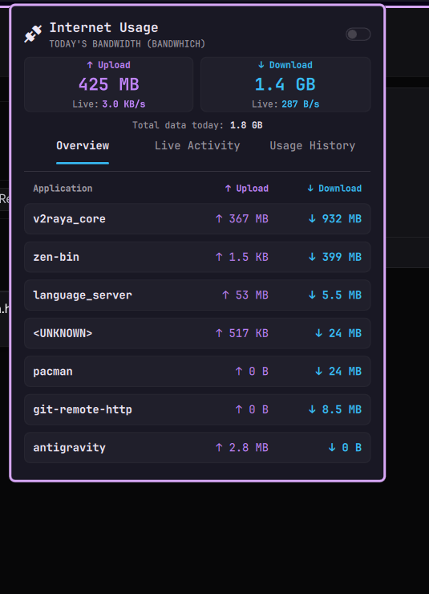
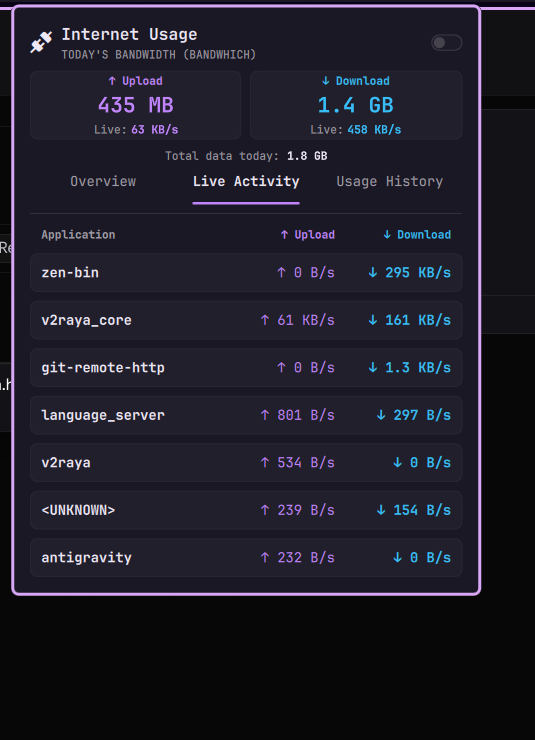
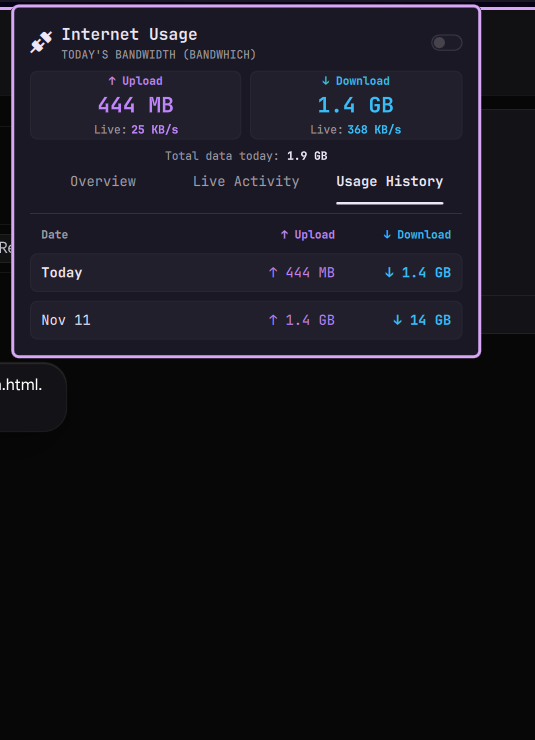

# Bandwidth Monitor for Omarchy

Daily internet bandwidth monitor plugin for Omarchy / Quickshell. Shows live daily bandwidth consumption and real-time network speeds directly in the status bar, paired with an interactive popup panel featuring process breakdowns and usage history.



## Features

- **Status Bar Widget**:
  - Displays live daily data consumption (`󱘖 13 GB`) or instantaneous transfer rates.
  - **Right-Click Cycling**: Right-click the bar widget anytime to cycle display modes:
    1. **Total Daily Usage** (`󱘖 13 GB`)
    2. **Current Download Speed** (`󱘖 ↓ 580 KB/s`)
    3. **Current Upload Speed** (`󱘖 ↑ 45 KB/s`)
  - Tooltip provides a quick summary of today's upload/download totals and active transfer speeds.

- **Minimal, Modern Popup Panel**:
  - **Compact Metric Cards**: Equal-width Upload (purple) and Download (cyan) summary cards with live speed subtext.
  - **Subtle Daily Total**: Clean, understated total data transferred readout.
  - **Theme Adaptive Mode**: Discrete top-right toggle switch to dynamically match colors and borders with your active Omarchy system theme.
  - **Overview Tab**: Full process breakdown ranked strictly by total bandwidth consumption (Upload + Download, highest consumer first).
  - **Live Activity Tab**: Real-time throughput per process with separate Upload and Download speed columns (ranked by active speed).
  - **Usage History Tab**: Daily bandwidth records archived for the past 30 days.

- **VPN & Proxy Transparent**:
  - Monitors raw socket packets directly via Linux capabilities.
  - Accurate process-level attribution even when traffic is encapsulated or routed through VPNs and proxies (such as v2raya, WireGuard, OpenVPN, Clash, Tailscale, etc.).

- **Efficient Daemon**:
  - Communicates with `bandwhich` via JSON streaming with minimal CPU and memory overhead.

---

## Screenshots

| Overview | Live Activity | Usage History |
| :---: | :---: | :---: |
|  |  |  |

---

## Dependencies

This plugin requires **`python3`** and **`bandwhich`**.

### 1. Install `bandwhich`

On Arch Linux / Omarchy:
```bash
sudo pacman -S bandwhich
```
*(or via cargo: `cargo install bandwhich`)*

### 2. Grant Network Capture Capabilities

`bandwhich` requires packet capture permissions to inspect socket traffic without running as root:

```bash
sudo setcap 'cap_sys_ptrace,cap_dac_read_search,cap_net_raw,cap_net_admin+ep' $(which bandwhich)
```

---

## Installation

Install using the Omarchy plugin CLI:

```bash
omarchy plugin install https://github.com/theju-bot/bandwidth.git
```

Once installed, add `theju-bot.bandwidth` to your bar configuration in `~/.config/omarchy/bar.json` (or via the Omarchy Settings panel):

```json
{
  "right": [
    "theju-bot.bandwidth"
  ]
}
```

Reload Quickshell / Omarchy to start the widget.

---

## Data & Storage

Usage statistics and state are stored in the standard XDG state directory:
- `~/.local/state/omarchy/theju-bot.bandwidth/stats.json`: Daily totals and process byte counters.
- `~/.local/state/omarchy/theju-bot.bandwidth/config.json`: Configuration settings.

---

## Uninstallation

To remove the plugin:

```bash
omarchy plugin remove theju-bot.bandwidth
```

Optionally remove state data:

```bash
rm -rf ~/.local/state/omarchy/theju-bot.bandwidth
```

---

## License

[MIT](LICENSE) © 2026 Thesigan Yogarasa
